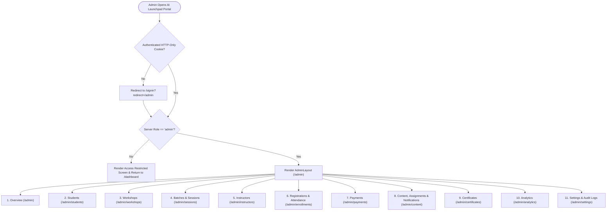
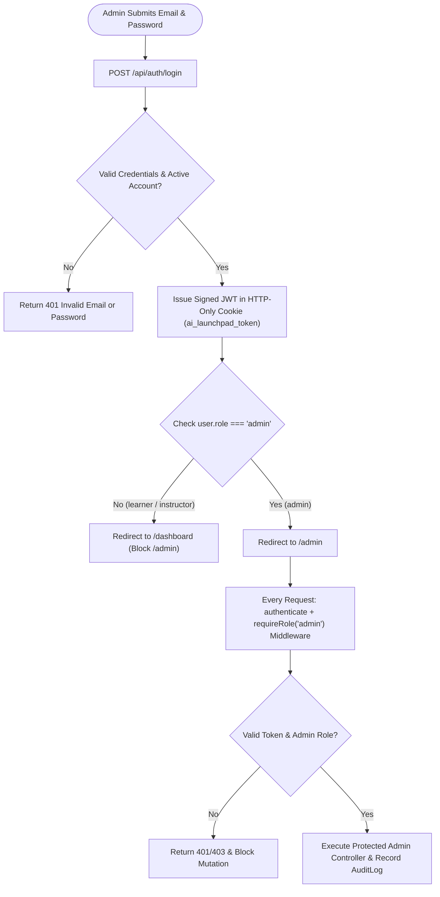
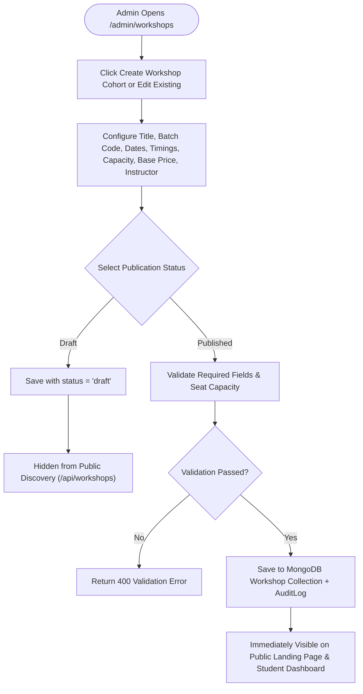
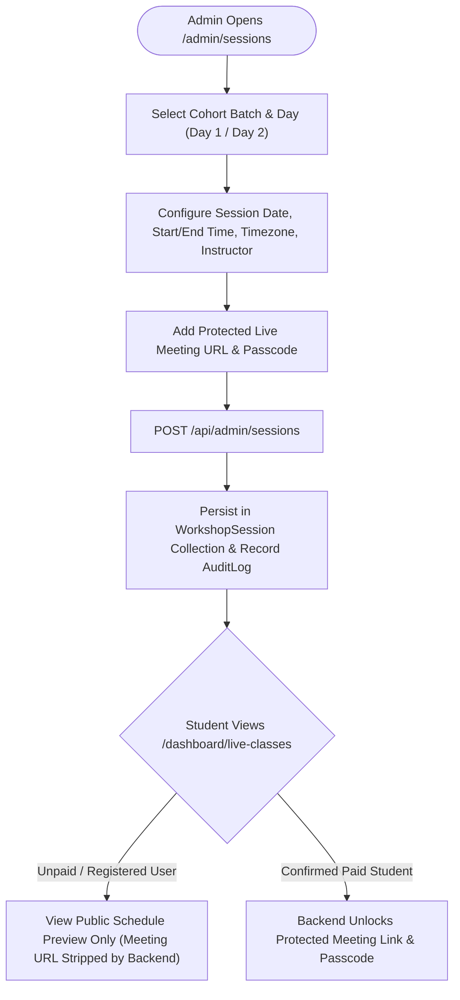
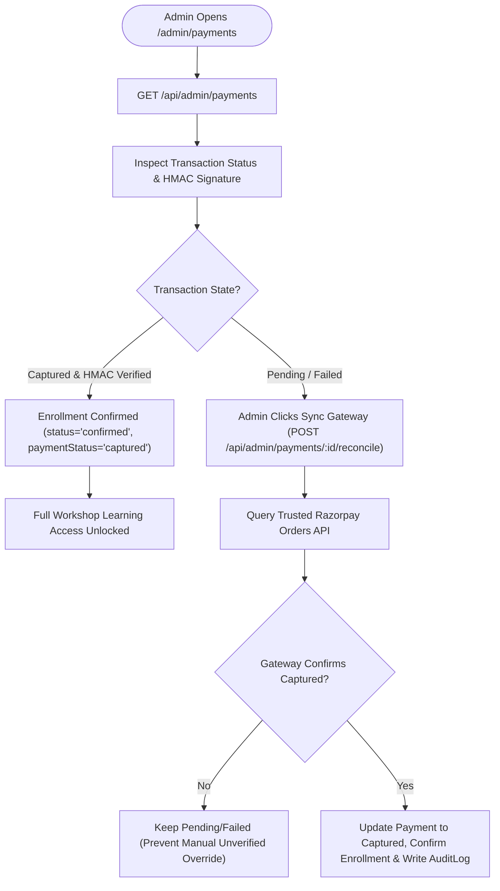
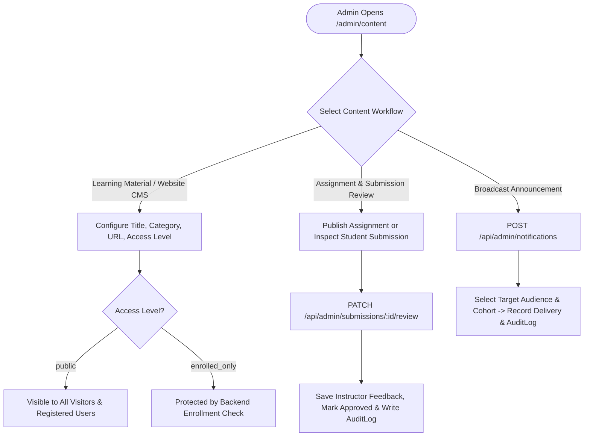
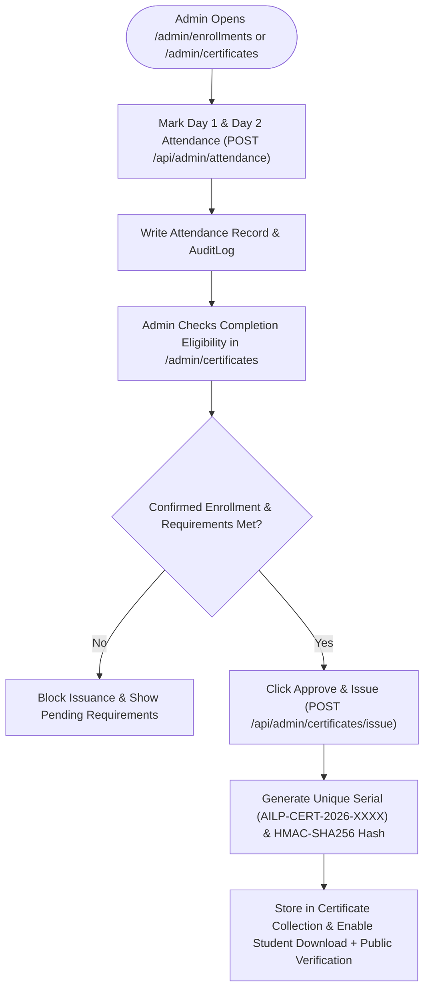
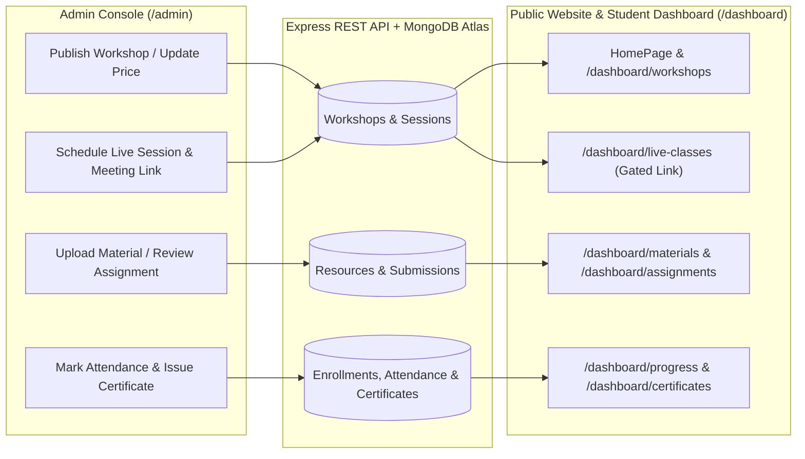

# AI Launchpad — Complete Administrator Flowcharts

This document defines the 8 core operational and architectural flowcharts for the **AI Launchpad** Administrator Portal (`https://ai-training-sessions-zeta.vercel.app/admin` and `http://localhost:5173/admin`).

---

## 1. Complete Admin Navigation Architecture

---

## 2. Admin Authentication and Server-Side RBAC Verification

---

## 3. Workshop Creation and Publishing Flow

---

## 4. Batch and Live Session Scheduling Flow

---

## 5. Payment Verification and Enrollment Confirmation Flow

---

## 6. Learning Materials, Assignments, and Notifications Flow

---

## 7. Attendance Verification and Certificate Issuance Flow

---

## 8. Admin-to-Student Real-Time Data Synchronization

