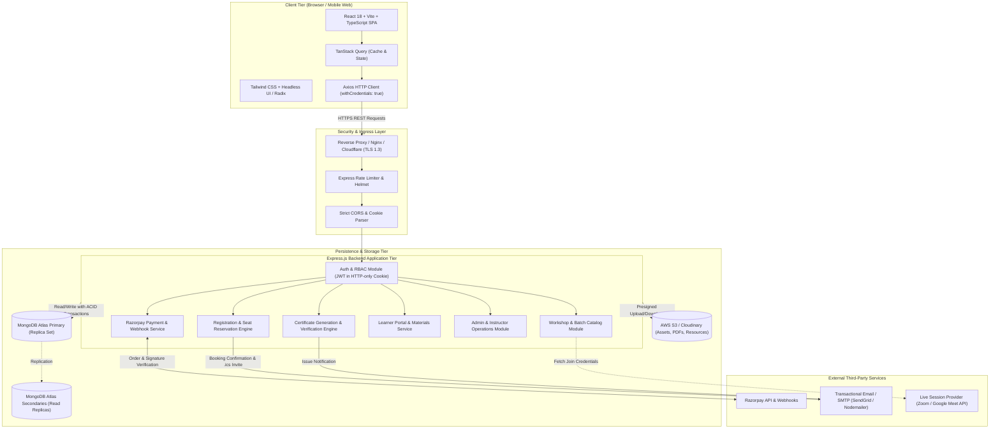
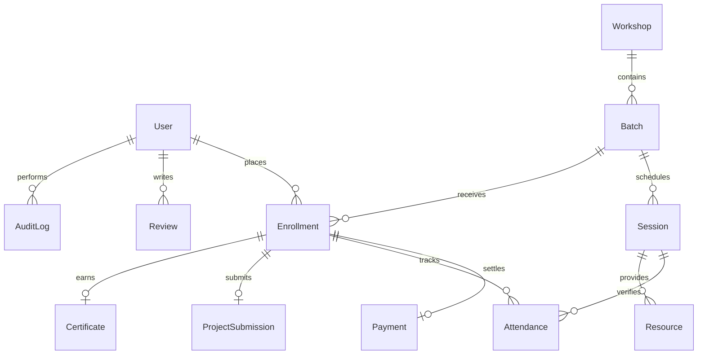
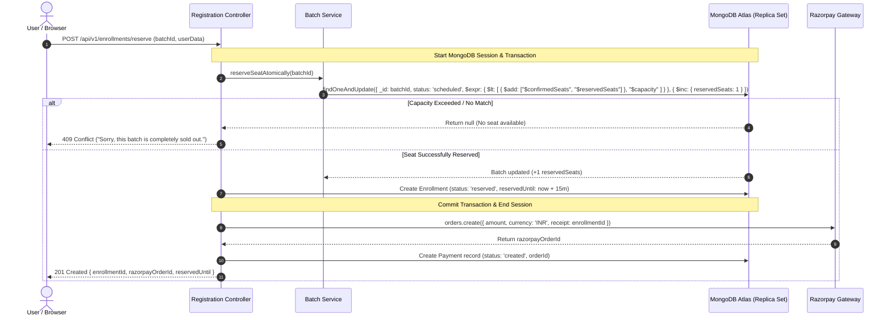
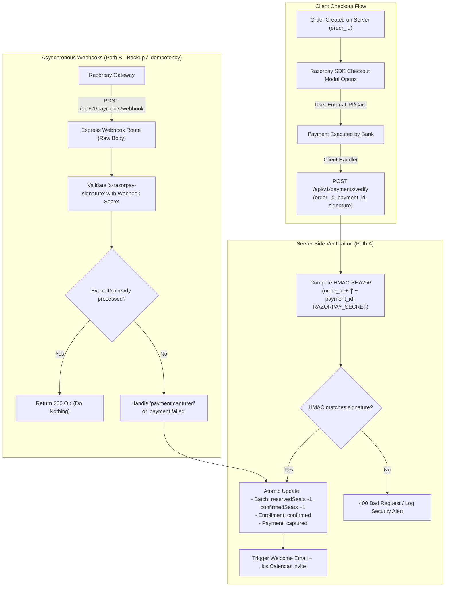

# High-Level Design (HLD): AI Launchpad — 2-Day Hands-On AI Bootcamp

**Document Version:** 1.0  
**Status:** Approved for Implementation (Phase 1 Deliverable)  
**Date:** November 1, 2026  
**Primary Requirements Source:** Product Requirements Document (PRD v1.0)  
**Author / Role:** Senior MERN Stack Solution Architect & Full-Stack Developer  

---

## 1. Executive Summary & Architectural Scope

The **AI Launchpad** platform is a modern, responsive, mobile-first web application designed for discovering, registering for, and participating in high-impact generative AI workshops—commencing with the flagship **2-Day Hands-On AI Bootcamp**. The platform provides:
1. A dynamic, high-converting public landing page driven by real-time database records (zero fabricated counters, seats, or pricing).
2. A resilient registration and transactional seat-capacity reservation engine.
3. An end-to-end payment pipeline integrating Razorpay with signature verification and webhook idempotency.
4. A secure, dedicated **Learner Portal** for session joining, resource downloads, capstone project submissions, and cryptographically verifiable PDF certificates.
5. An **Instructor & Admin Operations Portal** providing batch scheduling, real-time roster management, manual/automated attendance recording, content management, and auditable metrics.

### Technology Stack Constraints
- **Frontend:** React 18+ with TypeScript, Vite build tool, Tailwind CSS, TanStack Query (React Query), Lucide React icons.
- **Backend:** Node.js (v20+ LTS), Express.js (v4/v5) with TypeScript.
- **Database & ODM:** MongoDB Atlas (Replica Set supporting multi-document ACID transactions) with Mongoose (v8+).
- **Authentication:** Secure, HTTP-only Cookie-based JWT authentication with access/refresh token rotation and Role-Based Access Control (RBAC).
- **Payments:** Razorpay REST API & Webhooks (HMAC-SHA256 signature verification).
- **Communication & Storage:** S3-compatible object storage (AWS S3 or Cloudinary) for workshop materials and certificates; Nodemailer/SendGrid for transactional emails with `.ics` calendar attachments.

---

## 2. PRD Requirement Analysis & Architectural Invariants

### 2.1 Traceability Matrix
| PRD Section | Functional Scope | Architectural Implementation |
| :--- | :--- | :--- |
| **§6 Landing Page** | Hero, Outcomes, Audience Fit, 2-Day Curriculum, Mentors, Reviews, FAQ, Dynamic Batch Bar | Client-side React component hierarchy consuming `/api/v1/workshops` and `/api/v1/batches/live`. Dynamic rendering with zero hardcoded values. |
| **§7 Curriculum** | Day 1 (Foundations & Creation) & Day 2 (Building & Automation) | Normalized `CurriculumModule` and `Session` schemas allowing admin batch-specific customization. |
| **§9 Registration & Seats** | Multi-step form, anti-bot, capacity checks, temporary seat hold | MongoDB atomic `$expr` conditional update inside a transactional session; 15-minute seat reservation TTL. |
| **§10 Payments & Pricing** | Free and paid cohorts, Razorpay checkout, webhook handling, reconciliation | Server-side Razorpay order creation, client checkout modal, dual-path verification (client callback HMAC + signed webhooks), idempotent ledger. |
| **§11 Learner Portal** | My Workshops, Timezone-aware schedule, Resources, Projects, Certificates | Protected `/dashboard/*` routes, JWT auth middleware, presigned S3 URLs, PDF generation worker. |
| **§12 Admin/Instructor** | Batch creation, roster search/export, attendance, certificate issuance | Protected `/admin/*` and `/instructor/*` routes, RBAC middleware, auditable changes recorded to `AuditLog`. |
| **§17 NFRs** | WCAG 2.2 AA, <2s LCP, 99.9% uptime, data minimization, TLS, rate limits | Express Helmet, rate-limiter, MongoSanitize, strict Zod schemas, indexed queries, responsive mobile-first Tailwind design. |

### 2.2 Architectural Invariants & Non-Negotiables
1. **Zero Hardcoded Application State:** Registration counts, batch dates, seat availability, prices, reviews, and mentor profiles MUST originate from MongoDB Atlas via verified backend endpoints.
2. **Strict Concurrency Protection:** Under no circumstance can a batch oversell its defined `capacity`. Seat reservation must use atomic database operations (`$inc`) and transactional isolation.
3. **Zero Trust Payment Pipeline:** Client-reported payment status is never trusted. An enrollment is only transitioned to `confirmed` after cryptographically validating the Razorpay signature via server-side HMAC-SHA256 or verified server webhooks.
4. **Data Isolation & Least Privilege:** Learners can only query their own enrollments, payments, and certificates. Instructors can only access rosters for assigned batches.

---

## 3. High-Level System Architecture

The AI Launchpad platform follows a clean, decoupled, three-tier modular architecture designed for horizontal scalability, zero-downtime deployments, and strict separation of concerns.



---

## 4. React Frontend Component Hierarchy

The frontend is an optimized Single Page Application (SPA) built using React, Vite, TypeScript, and Tailwind CSS. It features a responsive layout system catering to mobile (320px–480px), tablet (768px–1024px), and desktop (1280px+) form factors.

### 4.1 Component Tree Hierarchy

```
<App>
 ├── <QueryClientProvider> (TanStack Query)
 └── <AuthProvider> (User session context, login status, roles)
      └── <BrowserRouter>
           ├── <PublicLayout>
           │    ├── <NavigationBar> (Logo, NavLinks, Sticky Register CTA, MobileMenu Drawer)
           │    │
           │    ├── <LandingPage> (/ route)
           │    │    ├── <HeroSection> (Headline, Sub-headline, Live Batch Badge, Primary CTA)
           │    │    ├── <TrustMetricsBar> (Verified alumni count, rating, authorized partners)
           │    │    ├── <LearningOutcomesGrid> (6 interactive outcome cards)
           │    │    ├── <AudienceFitSection> (Personas: Beginners, Professionals, Founders, Creators)
           │    │    ├── <CurriculumTabsSection> (Day 1 vs Day 2 toggle, Module accordions, Hands-on outputs)
           │    │    ├── <AIToolsShowcase> (Categorized AI tools with licensing/access caveats)
           │    │    ├── <MentorProfilesSection> (Verified instructor bios, credentials, photos)
           │    │    ├── <TestimonialsCarousel> (Source-verified student reviews with ratings)
           │    │    ├── <FAQAccordionSection> (Categorized questions, search filter)
           │    │    └── <BatchSelectorAndPricingCard> (Real-time seat meter, pricing summary, Register CTA)
           │    │
           │    ├── <WorkshopDetailsPage> (/workshops/:slug)
           │    ├── <CertificateVerificationPage> (/verify/:serial)
           │    ├── <LoginPage> (/login)
           │    ├── <RegisterPage> (/register)
           │    └── <Footer> (Legal links, privacy, terms, refund policy, copyright)
           │
           ├── <ProtectedLearnerRoute>
           │    └── <LearnerLayout> (Sidebar, TopHeader, NotificationBell)
           │         ├── <LearnerDashboardPage> (/dashboard)
           │         │    ├── <UpcomingSessionBanner> (Timezone-adjusted timer, "Join Live" button)
           │         │    └── <EnrolledBatchesList> (Active and past cohorts)
           │         ├── <BatchWorkspacePage> (/dashboard/batches/:batchId)
           │         │    ├── <SessionScheduleTimeline> (Day 1 & Day 2 agenda, join links)
           │         │    ├── <ResourceDownloadsTab> (Worksheets, prompt templates, tool guides)
           │         │    └── <ProjectSubmissionTab> (Capstone repo/URL submit, review feedback)
           │         ├── <CertificatesListPage> (/dashboard/certificates)
           │         │    └── <CertificateCard> (Preview, download PDF, share on LinkedIn)
           │         └── <UserProfilePage> (/dashboard/profile)
           │
           ├── <ProtectedAdminRoute>
           │    └── <AdminLayout> (AdminNav, SystemStatus)
           │         ├── <AdminOverviewPage> (/admin) (Live enrollment KPIs, revenue stats)
           │         ├── <BatchManagementPage> (/admin/batches) (Create batch, set capacity, pricing)
           │         ├── <EnrollmentRosterPage> (/admin/enrollments) (Filter, search, export CSV)
           │         ├── <AttendanceTrackerPage> (/admin/attendance) (Real-time session attendance marking)
           │         ├── <PaymentReconciliationPage> (/admin/payments) (Razorpay transaction log, refunds)
           │         ├── <ContentCMSPage> (/admin/content) (Update FAQs, mentors, workshop syllabus)
           │         └── <AuditLogsViewerPage> (/admin/audit-logs)
           │
           └── <CheckoutModalFlow> (Triggered anywhere upon clicking "Register Now")
                ├── <Step1_BatchSelection> (Select open cohort date & time)
                ├── <Step2_UserDetailsForm> (Name, email, phone, category, consent checkboxes)
                ├── <Step3_OrderSummary> (Price breakdown: base, tax, discount, final amount)
                └── <Step4_PaymentGatewayOverlay> (Razorpay SDK launch -> verification spinner -> success screen)
```

### 4.2 State Management & Network Strategy
- **Server Cache & Synchronization:** TanStack Query handles caching, background re-fetching, deduplication, and optimistic updates for batch availability, user profile, and enrollments.
- **Client Auth State:** A lightweight React Context (`AuthContext`) or Zustand store maintains the current user token state, authenticated role, and session expiration timer.
- **UI State:** Controlled components for tabs, accordions, and checkout modals using Tailwind transitions and accessible ARIA attributes.
- **Theme & Design Tokens:** Clean AI education theme using Tailwind:
  - Backgrounds: Dark Navy `#0B132B`, Slate Navy `#1C2541`
  - Accents: Electric Indigo `#6C5CE7`, Vibrant Violet `#7000FF`, Cyan Accent `#00D2D3`
  - Text: Off-white `#F8F9FA` for high contrast (WCAG AAA compliant on dark surfaces), Slate `#94A3B8` for secondary copy.

---

## 5. Express Backend Modules & REST API Specification

The backend is built with Express.js and TypeScript, adhering to a 4-layer architecture:
`Routes -> Middlewares -> Controllers -> Services -> Mongoose Models`.

```
                    ┌────────────────────────────┐
                    │      HTTP REST Client      │
                    └─────────────┬──────────────┘
                                  │
                    ┌─────────────▼──────────────┐
                    │   Express Route Definition │
                    └─────────────┬──────────────┘
                                  │
                    ┌─────────────▼──────────────┐
                    │ Middlewares (Auth/Zod/CORS)│
                    └─────────────┬──────────────┘
                                  │
                    ┌─────────────▼──────────────┐
                    │      Route Controller      │
                    └─────────────┬──────────────┘
                                  │
                    ┌─────────────▼──────────────┐
                    │  Business Service Layer    │
                    └─────────────┬──────────────┘
                                  │
                    ┌─────────────▼──────────────┐
                    │ Mongoose Models & Database │
                    └────────────────────────────┘
```

### 5.1 Endpoints Specification

#### A. Authentication & User Profile (`/api/v1/auth`)
| Method | Endpoint | Access | Description |
| :--- | :--- | :--- | :--- |
| `POST` | `/api/v1/auth/register` | Public | Register new user account; sends verification email. |
| `POST` | `/api/v1/auth/login` | Public | Authenticates credentials; issues HTTP-only JWT cookies. |
| `POST` | `/api/v1/auth/refresh` | Public | Exchanges valid refresh token for a new access token. |
| `POST` | `/api/v1/auth/logout` | Authenticated | Clears auth cookies and invalidates refresh session in DB. |
| `GET` | `/api/v1/auth/me` | Authenticated | Returns current authenticated user profile & permissions. |
| `PUT` | `/api/v1/auth/profile` | Authenticated | Updates user profile information and communication consent. |

#### B. Workshops & Curriculum (`/api/v1/workshops`)
| Method | Endpoint | Access | Description |
| :--- | :--- | :--- | :--- |
| `GET` | `/api/v1/workshops` | Public | Lists active published workshops with summary details. |
| `GET` | `/api/v1/workshops/:slug` | Public | Returns complete workshop landing data (modules, mentors, FAQs). |
| `POST` | `/api/v1/workshops` | Admin | Creates a new workshop specification. |
| `PUT` | `/api/v1/workshops/:id` | Admin | Updates workshop syllabus, outcomes, and metadata. |

#### C. Batches & Real-Time Availability (`/api/v1/batches`)
| Method | Endpoint | Access | Description |
| :--- | :--- | :--- | :--- |
| `GET` | `/api/v1/batches/live` | Public | Returns open future cohorts with dynamic available seat counts. |
| `GET` | `/api/v1/batches/:id` | Public | Returns specific batch details, timing, instructor, and price. |
| `POST` | `/api/v1/batches` | Admin | Schedules a new cohort (sets start/end time, capacity, pricing). |
| `PATCH`| `/api/v1/batches/:id/status`| Admin | Transitions batch status (`scheduled`, `full`, `closed`, `canceled`). |

#### D. Registration & Seat Reservation (`/api/v1/enrollments`)
| Method | Endpoint | Access | Description |
| :--- | :--- | :--- | :--- |
| `POST` | `/api/v1/enrollments/reserve`| Public/Auth | Validates user, checks capacity, atomically holds seat for 15 min. |
| `GET` | `/api/v1/enrollments/my` | Learner | Retrieves authenticated user's enrolled workshops & access passes. |
| `GET` | `/api/v1/enrollments/:id` | Learner/Admin| Retrieves specific enrollment confirmation and receipt. |
| `POST` | `/api/v1/enrollments/:id/cancel`| Learner/Admin| Cancels registration and releases reserved seat. |

#### E. Payments & Razorpay Integration (`/api/v1/payments`)
| Method | Endpoint | Access | Description |
| :--- | :--- | :--- | :--- |
| `POST` | `/api/v1/payments/create-order`| Authenticated | Generates server-side Razorpay Order ID for a reserved enrollment. |
| `POST` | `/api/v1/payments/verify` | Authenticated | Validates client Razorpay HMAC-SHA256 signature and confirms seat. |
| `POST` | `/api/v1/payments/webhook` | External (Razorpay)| Idempotent webhook receiver for `payment.captured`, `payment.failed`. |
| `POST` | `/api/v1/payments/:id/refund` | Admin | Initiates partial or full refund through Razorpay API. |

#### F. Learner Portal, Materials & Submissions (`/api/v1/learners`)
| Method | Endpoint | Access | Description |
| :--- | :--- | :--- | :--- |
| `GET` | `/api/v1/learners/sessions/:batchId`| Enrolled Learner| Returns session agenda with time-gated live joining URL. |
| `GET` | `/api/v1/learners/resources/:batchId`| Enrolled Learner| Generates signed download URLs for workshop files & templates. |
| `POST` | `/api/v1/learners/submissions` | Enrolled Learner| Submits capstone project link/repo for review. |

#### G. Attendance, Certificates & Administration (`/api/v1/admin`)
| Method | Endpoint | Access | Description |
| :--- | :--- | :--- | :--- |
| `POST` | `/api/v1/admin/attendance/mark` | Instructor/Admin | Records attendance for a session (present/absent/late). |
| `POST` | `/api/v1/admin/certificates/issue`| Admin | Generates cryptographically signed PDF certificate. |
| `GET` | `/api/v1/public/certificates/verify/:serial`| Public | Validates authentic certificate serial ID and owner name. |
| `GET` | `/api/v1/admin/roster/:batchId` | Instructor/Admin | Returns batch roster with export options (CSV/JSON). |
| `GET` | `/api/v1/admin/audit-logs` | Super Admin | Queries tamper-evident administrative action log. |

---

## 6. MongoDB Collections, Mongoose Schemas & Data Model

MongoDB Atlas is the single source of truth for persistent application data. All collections use strict Mongoose schemas with validation, defaults, and compound indexes to ensure fast reads and transactional integrity.

### 6.1 Entity-Relationship Diagram (ERD)



### 6.2 Detailed Mongoose Schemas

#### 1. User Schema (`users`)
```typescript
interface IUser {
  _id: Types.ObjectId;
  fullName: string;
  email: string;
  passwordHash?: string;
  phone: {
    countryCode: string;
    number: string;
  };
  role: 'learner' | 'instructor' | 'support' | 'admin' | 'super_admin';
  category: 'student' | 'working_professional' | 'founder' | 'creator' | 'other';
  experienceLevel?: 'beginner' | 'intermediate' | 'advanced';
  isEmailVerified: boolean;
  termsAcceptedAt: Date;
  marketingConsent: boolean;
  refreshTokens: string[];
  createdAt: Date;
  updatedAt: Date;
}
// Indexes:
// { email: 1 } (Unique, sparse)
// { "phone.number": 1, "phone.countryCode": 1 }
// { role: 1 }
```

#### 2. Workshop Schema (`workshops`)
```typescript
interface IWorkshop {
  _id: Types.ObjectId;
  slug: string; // e.g., "ai-launchpad-2-day-bootcamp"
  title: string;
  headline: string;
  description: string;
  durationDays: number; // 2
  format: 'live_online' | 'hybrid' | 'in_person';
  prerequisites: string[];
  learningOutcomes: Array<{
    title: string;
    description: string;
    icon: string;
  }>;
  curriculum: Array<{
    dayNumber: number;
    title: string;
    modules: Array<{
      order: number;
      moduleName: string;
      topics: string[];
      handsOnOutput: string;
    }>;
  }>;
  aiToolsCovered: Array<{
    name: string;
    category: string;
    logoUrl: string;
    pricingNote: string;
  }>;
  faqs: Array<{
    question: string;
    answer: string;
    category: string;
  }>;
  status: 'draft' | 'published' | 'archived';
  createdAt: Date;
  updatedAt: Date;
}
// Indexes:
// { slug: 1 } (Unique)
// { status: 1 }
```

#### 3. Batch Schema (`batches`)
```typescript
interface IBatch {
  _id: Types.ObjectId;
  workshopId: Types.ObjectId; // Ref: Workshop
  batchCode: string; // e.g., "AILP-2026-NOV-01"
  startAt: Date;
  endAt: Date;
  timezone: string; // e.g., "Asia/Kolkata"
  capacity: number; // e.g., 100
  reservedSeats: number; // Temporary holds (default: 0)
  confirmedSeats: number; // Paid / Confirmed (default: 0)
  pricing: {
    isFree: boolean;
    basePrice: number; // in smallest currency unit (e.g. paise: 199900 = ₹1,999)
    currency: string; // "INR"
    taxPercentage: number; // e.g. 18 for 18% GST
  };
  registrationCutoffAt: Date;
  status: 'scheduled' | 'filling_fast' | 'full' | 'closed' | 'in_progress' | 'completed' | 'canceled';
  meetingConfig: {
    platform: 'zoom' | 'google_meet';
    joinUrl: string;
    passcode?: string;
  };
  leadInstructorId: Types.ObjectId; // Ref: User
  createdAt: Date;
  updatedAt: Date;
}
// Indexes:
// { batchCode: 1 } (Unique)
// { workshopId: 1, status: 1, startAt: 1 }
// { registrationCutoffAt: 1 }
```

#### 4. Enrollment Schema (`enrollments`)
```typescript
interface IEnrollment {
  _id: Types.ObjectId;
  enrollmentId: string; // e.g., "ENR-2026-89472" (Unique user-facing ID)
  userId: Types.ObjectId; // Ref: User
  batchId: Types.ObjectId; // Ref: Batch
  workshopId: Types.ObjectId; // Ref: Workshop
  status: 'pending' | 'reserved' | 'confirmed' | 'canceled' | 'refunded' | 'attended' | 'completed';
  reservedUntil?: Date; // 15-minute countdown for checkout
  paymentId?: Types.ObjectId; // Ref: Payment
  attendanceSummary: {
    day1Attended: boolean;
    day2Attended: boolean;
    totalSessionsAttended: number;
  };
  certificateIssued: boolean;
  certificateId?: Types.ObjectId; // Ref: Certificate
  utmParams?: {
    source: string;
    medium: string;
    campaign: string;
  };
  createdAt: Date;
  updatedAt: Date;
}
// Indexes:
// { enrollmentId: 1 } (Unique)
// { userId: 1, batchId: 1 } (Unique compound: prevents duplicate active enrollments)
// { batchId: 1, status: 1 }
// { status: 1, reservedUntil: 1 } (TTL / cleanup query index)
```

#### 5. Payment Schema (`payments`)
```typescript
interface IPayment {
  _id: Types.ObjectId;
  enrollmentId: Types.ObjectId; // Ref: Enrollment
  userId: Types.ObjectId; // Ref: User
  batchId: Types.ObjectId; // Ref: Batch
  provider: 'razorpay' | 'free_tier';
  razorpayOrderId?: string;
  razorpayPaymentId?: string;
  razorpaySignature?: string;
  amount: number; // in paise
  taxAmount: number;
  currency: string; // "INR"
  status: 'created' | 'attempted' | 'captured' | 'failed' | 'refunded';
  failureReason?: string;
  idempotencyKey: string; // Prevents processing duplicate events
  webhookEventsReceived: string[]; // List of processed Razorpay event IDs
  refundDetails?: {
    refundId: string;
    amount: number;
    reason: string;
    processedAt: Date;
  };
  createdAt: Date;
  updatedAt: Date;
}
// Indexes:
// { razorpayOrderId: 1 } (Unique, sparse)
// { razorpayPaymentId: 1 } (Unique, sparse)
// { idempotencyKey: 1 } (Unique)
// { enrollmentId: 1 }
```

#### 6. Session & Attendance Schemas (`sessions`, `attendances`)
```typescript
interface ISession {
  _id: Types.ObjectId;
  batchId: Types.ObjectId;
  dayNumber: number; // 1 or 2
  sessionTitle: string;
  startAt: Date;
  endAt: Date;
  joinUrl: string;
  instructorId: Types.ObjectId;
}

interface IAttendance {
  _id: Types.ObjectId;
  enrollmentId: Types.ObjectId;
  sessionId: Types.ObjectId;
  status: 'present' | 'absent' | 'excused';
  markedBy: Types.ObjectId; // Ref: User (Instructor or Admin)
  markedAt: Date;
  notes?: string;
}
// Indexes:
// { enrollmentId: 1, sessionId: 1 } (Unique compound)
```

#### 7. Certificate Schema (`certificates`)
```typescript
interface ICertificate {
  _id: Types.ObjectId;
  serialNumber: string; // e.g. "AILP-CERT-2026-X9B2"
  enrollmentId: Types.ObjectId;
  userId: Types.ObjectId;
  recipientName: string;
  workshopTitle: string;
  completionDate: Date;
  pdfUrl: string;
  verificationHash: string; // SHA-256 hash of serial + user details
  isRevoked: boolean;
  revokedReason?: string;
  createdAt: Date;
}
// Indexes:
// { serialNumber: 1 } (Unique)
// { verificationHash: 1 } (Unique)
// { enrollmentId: 1 } (Unique)
```

---

## 7. User Authentication & Role-Based Authorization (RBAC)

### 7.1 Authentication Architecture
The platform implements a secure, stateless JWT architecture using **Dual-Token Rotation** delivered via secure **HTTP-Only Cookies**. This avoids localStorage XSS vulnerabilities entirely.

```
       Client Request              Express Middleware                 Database
  ┌──────────────────────┐     ┌────────────────────────┐      ┌─────────────────────┐
  │ HTTP Request with    ├────►│ Check Access Cookie    │      │                     │
  │ accessToken cookie   │     │ - Valid & Not Expired? ├──────► Allow Request       │
  └──────────────────────┘     │   (Proceed to Route)   │      │                     │
                               │ - Expired?             │      │                     │
                               │   Check Refresh Cookie ├──────► Verify in DB Session│
                               │   Issue New Token Pair │      │ Invalidate Old RT   │
                               └────────────────────────┘      └─────────────────────┘
```

- **Access Token:** Short lifespan (15 minutes). Payload contains `{ userId, email, role }`. Signed with `JWT_ACCESS_SECRET`.
- **Refresh Token:** Long lifespan (7 days). Stored in a separate HTTP-only cookie and hashed in the `User.refreshTokens` collection in MongoDB. Signed with `JWT_REFRESH_SECRET`.
- **Cookie Security Attributes:**
  ```javascript
  {
    httpOnly: true,
    secure: process.env.NODE_ENV === 'production', // Requires HTTPS
    sameSite: 'strict',
    path: '/',
    maxAge: 7 * 24 * 60 * 60 * 1000 // 7 days
  }
  ```

### 7.2 RBAC Permission Matrix

| Operation / Scope | Learner | Instructor | Support | Admin | Super Admin |
| :--- | :---: | :---: | :---: | :---: | :---: |
| View Public Workshops & Batches | ✅ | ✅ | ✅ | ✅ | ✅ |
| Register & Pay for Workshop | ✅ | ❌ | ❌ | ❌ | ❌ |
| Access Own Dashboard & Join Links | ✅ | ❌ | ❌ | ❌ | ❌ |
| Submit Own Capstone Project | ✅ | ❌ | ❌ | ❌ | ❌ |
| Download Own Certificate | ✅ | ❌ | ❌ | ❌ | ❌ |
| View Assigned Batch Rosters | ❌ | ✅ | ✅ | ✅ | ✅ |
| Mark Batch Session Attendance | ❌ | ✅ | ❌ | ✅ | ✅ |
| Review Student Submissions | ❌ | ✅ | ❌ | ✅ | ✅ |
| Manage Workshops, Batches, Pricing | ❌ | ❌ | ❌ | ✅ | ✅ |
| Process Cancellations & Refunds | ❌ | ❌ | ❌ | ✅ | ✅ |
| Assign Roles & Manage Staff Accounts | ❌ | ❌ | ❌ | ❌ | ✅ |
| View Audit Logs & System Secrets | ❌ | ❌ | ❌ | ❌ | ✅ |

### 7.3 Authorization Middleware Implementation Pattern
```typescript
// middlewares/auth.middleware.ts
export const authorize = (...allowedRoles: string[]) => {
  return (req: Request, res: Response, next: NextFunction) => {
    if (!req.user || !allowedRoles.includes(req.user.role)) {
      return res.status(403).json({
        success: false,
        message: 'Forbidden: Insufficient privileges to access this resource.'
      });
    }
    next();
  };
};
```

---

## 8. Workshop Registration, Seat Availability & Concurrency Workflow

One of the most critical aspects of the AI Launchpad platform is preventing race conditions and overselling seats during peak marketing campaigns.

### 8.1 Concurrency & ACID Multi-Document Transactions



### 8.2 Seat Hold Expiration & Background Janitor
- If a user closes their browser or abandons payment, the 15-minute reservation expires.
- **Automated Cleanup Worker:** A Node.js background cron job runs every 2 minutes:
  ```typescript
  // workers/seatCleanup.worker.ts
  export async function releaseExpiredReservations() {
    const session = await mongoose.startSession();
    session.startTransaction();
    try {
      const expiredEnrollments = await Enrollment.find({
        status: 'reserved',
        reservedUntil: { $lt: new Date() }
      }).session(session);

      for (const enr of expiredEnrollments) {
        enr.status = 'canceled';
        await enr.save({ session });

        await Batch.findByIdAndUpdate(
          enr.batchId,
          { $inc: { reservedSeats: -1 } },
          { session }
        );
      }
      await session.commitTransaction();
    } catch (err) {
      await session.abortTransaction();
    } finally {
      session.endSession();
    }
  }
  ```

---

## 9. Payment Verification Architecture (Razorpay Integration)

To uphold the **Zero Trust Client** architectural invariant, client-reported payment events are never accepted without cryptographic proof.

### 9.1 Dual-Verification Flow



### 9.2 HMAC-SHA256 Signature Verification Code
```typescript
// services/payment.service.ts
import crypto from 'crypto';

export function verifyRazorpaySignature(
  orderId: string,
  paymentId: string,
  signature: string,
  secret: string
): boolean {
  const generatedSignature = crypto
    .createHmac('sha256', secret)
    .update(`${orderId}|${paymentId}`)
    .digest('hex');

  return crypto.timingSafeEqual(
    Buffer.from(generatedSignature, 'utf-8'),
    Buffer.from(signature, 'utf-8')
  );
}
```

---

## 10. Environment Variables & Security Considerations

### 10.1 Environment Variables Specification

#### Backend `.env.example`
```bash
# Server Configuration
NODE_ENV=development
PORT=5000
API_PREFIX=/api/v1
CLIENT_ORIGIN=http://localhost:5173

# Database (MongoDB Atlas)
MONGODB_URI=mongodb+srv://<username>:<password>@cluster0.mongodb.net/ai_launchpad?retryWrites=true&w=majority

# JWT Authentication Secrets
JWT_ACCESS_SECRET=your_super_secret_access_key_min_32_chars_long
JWT_REFRESH_SECRET=your_super_secret_refresh_key_min_32_chars_long
JWT_ACCESS_EXPIRY=15m
JWT_REFRESH_EXPIRY=7d
COOKIE_SECRET=your_cookie_signing_secret_hash

# Razorpay Integration
RAZORPAY_KEY_ID=rzp_test_YourTestKeyId
RAZORPAY_KEY_SECRET=YourRazorpaySecretKey
RAZORPAY_WEBHOOK_SECRET=YourRazorpayWebhookSecretKey

# Object Storage (S3 / Cloudinary)
STORAGE_BUCKET_NAME=ai-launchpad-assets
STORAGE_REGION=ap-south-1
STORAGE_ACCESS_KEY=your_aws_access_key
STORAGE_SECRET_KEY=your_aws_secret_key

# Transactional Email (SendGrid / Nodemailer)
SMTP_HOST=smtp.sendgrid.net
SMTP_PORT=587
SMTP_USER=apikey
SMTP_PASS=your_sendgrid_api_key
EMAIL_FROM_ADDRESS="AI Launchpad Team <team@ailaunchpad.edu>"

# Security & Rate Limiting
RATE_LIMIT_WINDOW_MS=900000 # 15 minutes
RATE_LIMIT_MAX_REQUESTS=100
```

#### Frontend `.env.example`
```bash
VITE_API_BASE_URL=http://localhost:5000/api/v1
VITE_RAZORPAY_KEY_ID=rzp_test_YourTestKeyId
VITE_APP_NAME="AI Launchpad"
VITE_SUPPORT_EMAIL="support@ailaunchpad.edu"
```

### 10.2 Security Best Practices & Hardening
1. **OWASP Top 10 Mitigation:**
   - **NoSQL Injection:** Strict validation via `express-mongo-sanitize` to strip `$` and `.` from request payloads.
   - **Cross-Site Scripting (XSS):** HTTP-only cookies prevent JavaScript access to auth tokens; React automatically escapes JSX expressions.
   - **Cross-Site Request Forgery (CSRF):** `SameSite=Strict` cookie policy, combined with custom API headers (`X-Requested-With`).
   - **Rate Limiting:** `express-rate-limit` throttles brute force attempts on `/auth/login` (5 attempts per 15 min) and `/enrollments/reserve` (10 per IP per hour).
2. **HTTP Security Headers:**
   - `helmet()` configures Content Security Policy (CSP), Strict-Transport-Security (HSTS), X-Content-Type-Options (`nosniff`), and frameguard (`DENY`).
3. **Data Minimization & Compliance:**
   - Zero storage of raw credit/debit card numbers or CVVs (handled entirely within Razorpay’s PCI-DSS compliant iframe).
   - User phone and email are encrypted at rest; marketing consent flags are stored with explicit timestamps for GDPR/DPDP Act compliance.

---

## 11. Recommended Clean, Scalable MERN Folder Structure

A standardized, modular monorepo structure separating the React frontend and Express backend while sharing TypeScript interfaces.

```
ai-launchpad/
├── .gitignore
├── README.md
├── package.json                   # Workspace root runner (npm/pnpm workspaces)
│
├── packages/
│   └── shared-types/              # Shared TS types across client & server
│       ├── package.json
│       ├── src/
│       │   ├── user.types.ts
│       │   ├── workshop.types.ts
│       │   ├── batch.types.ts
│       │   ├── enrollment.types.ts
│       │   └── payment.types.ts
│       └── tsconfig.json
│
├── client/                        # Frontend Application (React + Vite + Tailwind)
│   ├── index.html
│   ├── package.json
│   ├── postcss.config.js
│   ├── tailwind.config.js
│   ├── tsconfig.json
│   ├── vite.config.ts
│   └── src/
│       ├── main.tsx
│       ├── App.tsx
│       ├── assets/                # Logos, illustrations, fallback images
│       ├── components/            # Reusable Atomic UI Components
│       │   ├── ui/                # Button, Modal, Card, Accordion, Badge, Input
│       │   ├── layout/            # Navbar, Footer, LearnerSidebar, AdminNav
│       │   └── feedback/          # ToastNotification, LoadingSpinner, ErrorAlert
│       ├── features/              # Domain-Driven Feature Modules
│       │   ├── landing/           # Hero, CurriculumTabs, Mentors, Reviews, FAQ
│       │   ├── checkout/          # BatchSelector, RegistrationForm, RazorpayModal
│       │   ├── learner/           # SessionSchedule, ResourcesTab, SubmissionForm
│       │   └── admin/             # BatchForm, RosterTable, AttendanceSheet, MetricsGrid
│       ├── hooks/                 # Custom React Hooks (useAuth, useBatchSeats, useCountdown)
│       ├── context/               # AuthContext, NotificationContext
│       ├── services/              # Axios API client instances and query helpers
│       ├── utils/                 # Currency formatters, timezone converters, validators
│       └── types/                 # Frontend-specific type augmentations
│
└── server/                        # Backend Application (Node.js + Express + Mongoose)
    ├── package.json
    ├── tsconfig.json
    ├── .env.example
    └── src/
        ├── server.ts              # App entry point, HTTP listener, graceful shutdown
        ├── app.ts                 # Express initialization, middleware pipeline
        ├── config/                # Environment variables, DB connection, Razorpay client
        ├── constants/             # Enums, error codes, HTTP status constants
        ├── middlewares/           # Auth, RBAC, Zod validator, ErrorHandler, RateLimiter
        ├── models/                # Mongoose Models (User, Workshop, Batch, Enrollment, etc.)
        ├── modules/               # Modular Domain Endpoints
        │   ├── auth/              # auth.routes.ts, auth.controller.ts, auth.service.ts
        │   ├── workshops/         # workshop.routes.ts, workshop.controller.ts, workshop.service.ts
        │   ├── batches/           # batch.routes.ts, batch.controller.ts, batch.service.ts
        │   ├── enrollments/       # enrollment.routes.ts, enrollment.controller.ts, enrollment.service.ts
        │   ├── payments/          # payment.routes.ts, payment.controller.ts, payment.service.ts
        │   ├── learners/          # learner.routes.ts, learner.controller.ts, learner.service.ts
        │   └── admin/             # admin.routes.ts, admin.controller.ts, admin.service.ts
        ├── services/              # Cross-cutting services: EmailService, StorageService, PDFService
        ├── workers/               # Cron jobs: seatReservationCleanup, emailReminderWorker
        └── utils/                 # Custom error classes, HMAC verification, logger
```

---

## 12. Technical Implementation Roadmap & Acceptance Criteria

Mapped directly against Section 20 of the PRD, the project will be executed across 6 focused technical phases.

### Phase 1: Foundation, Infrastructure & Core Schema Setup
- **Objectives:** Initialize monorepo, configure TypeScript/Vite/Tailwind, configure Express with security middleware, establish MongoDB Atlas replica set connection, and define core Mongoose schemas.
- **Acceptance Criteria:**
  1. MongoDB Atlas connects securely via Mongoose with debug logging in development.
  2. All 10 Mongoose schemas (User, Workshop, Batch, Session, Enrollment, Payment, Attendance, Resource, Certificate, AuditLog) compile with strict TypeScript interfaces.
  3. Base health check endpoint `/api/v1/health` returns `200 OK` with database ping time.

### Phase 2: Dynamic Public Landing Page & Catalog Engine
- **Objectives:** Build responsive landing page in React; build backend endpoints for workshops, syllabus, and real-time live batches.
- **Acceptance Criteria:**
  1. Landing page renders Hero, 6 Outcome cards, Day 1/Day 2 Curriculum tabs, Tools, Mentors, and FAQ dynamically from MongoDB.
  2. Zero hardcoded counters, dates, or prices exist in the client code.
  3. Mobile-first responsive layout tested across 320px, 768px, and 1280px viewports (WCAG 2.2 AA compliant).

### Phase 3: Authentication, Registration & Concurrency Engine
- **Objectives:** Implement HTTP-only cookie-based JWT authentication, multi-step registration form, and transactional seat reservation logic.
- **Acceptance Criteria:**
  1. Concurrent registrations for the final seat in a batch result in exactly one successful reservation and one graceful `409 Conflict` (no overselling).
  2. Temporary seat hold decrements available seats and expires after 15 minutes via background worker if abandoned.
  3. Users receive a unique, formatted enrollment ID (e.g. `ENR-2026-XXXXX`).

### Phase 4: Razorpay Payment Gateway & Dual Verification
- **Objectives:** Integrate Razorpay SDK on frontend and server; implement HMAC-SHA256 signature verification and webhook listeners.
- **Acceptance Criteria:**
  1. Client payment modal opens with calculated base price + GST breakdown.
  2. Payment is transitioned to `confirmed` ONLY after server-side HMAC-SHA256 signature verification.
  3. Webhook listener handles `payment.captured` idempotently without duplicate records.
  4. System dispatches booking confirmation email with attached `.ics` calendar invite upon confirmation.

### Phase 5: Learner Portal, Materials & Capstone Submissions
- **Objectives:** Create protected `/dashboard` learner experience with live session joining, resource downloads, and capstone submissions.
- **Acceptance Criteria:**
  1. Live meeting join button activates only within the scheduled session window (e.g., 15 minutes before start time).
  2. Resource download links generate short-lived presigned URLs.
  3. Learners can submit capstone project links and view evaluation status.

### Phase 6: Admin/Instructor Console, Attendance, Certificates & Audit
- **Objectives:** Develop operations console for scheduling cohorts, live roster search, attendance recording, and PDF certificate issuance.
- **Acceptance Criteria:**
  1. Instructors can mark attendance per session; attendance statistics calculate automatically.
  2. Eligible attendees can view and download cryptographically verifiable PDF certificates.
  3. Public verification endpoint `/api/v1/public/certificates/verify/:serial` verifies certificate validity without requiring authentication.
  4. All administrative actions write tamper-evident records to `AuditLog`.

---

## 13. Document Sign-Off & Next Steps
This High-Level Design document establishes the technical blueprint for the **AI Launchpad** platform. Phase 2 (Detailed Architecture & Database Implementation) will begin immediately upon sign-off.

